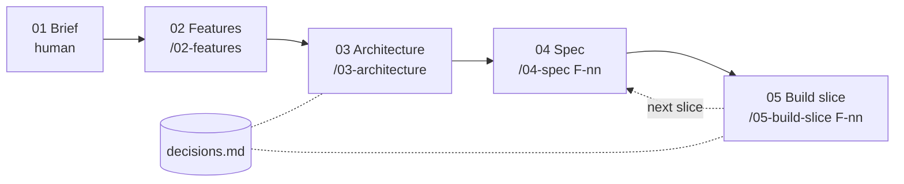

# Digital transformation project · AI harness

A repository template for taking a business's existing process online — from a vague request
to a working, tested vertical slice — with AI doing the structuring and building, and humans
owning discovery and every decision.

**Use:** "Use this template" on GitHub → one repo per client project.

## Why a harness, not just prompts

- **The repo is the single source of truth.** Brief, features, diagrams, specs and decisions
  live next to the code as Markdown + Mermaid. They are the AI's context — nothing gets lost
  copying between a whiteboard, a notes app and a prompt.
- **Every step is traceable.** Features cite brief sections, tests are named after Gherkin
  scenarios, deviations become decision records. Anything the AI had to assume is listed, not hidden.
- **Humans decide, AI proposes.** Each skill ends at a review point. Scope proposals carry a `?`
  until a human removes it.
- **Quality gates are automatic.** Hooks lint every edit and run the tests before Claude may
  declare a step done.

## Process



| Step | What happens | Review point |
|---|---|---|
| 01 Brief | Discovery interview in business language, typed live into 11 sections | — |
| 02 Features | Job stories, Kano classification, AI opportunities, proposed scope, cut list | Validate must-bes with the business; remove the `?` |
| 03 Architecture | Context, capability register, data model, key flows, API surface, scalability notes | Review diagrams; accept or reject proposed decisions |
| 04 Spec | 4–6 Gherkin scenarios for one feature | Edit scenarios — they become the tests |
| 05 Build slice | Plan → tests → data → API → thin UI, committed at each green checkpoint | Approve the plan; review the migration and diffs |

Numbers follow the process; each skill carries the number of the document it produces.
Step 01 has no skill on purpose: discovery is a conversation between people.

## Scope levels

| Scope | Meaning |
|---|---|
| `v0` | First working build, to validate with the business — capabilities may be fake |
| `v1` | First release to real customers — every capability real |
| `v2` | Next iteration after launch |
| `cut` | Not building, with the reason recorded |

## External capabilities

The business describes what it uses today in plain words (brief §8). Architecture turns that
into a **capability register**: for each capability (taking payment, sending messages, …) it
judges whether today's system fits a web solution and proposes to keep, replace, add or leave
it manual. Capabilities sit behind ports, so v0 can run on fakes while the vendor decision is
made separately before v1 (D-01).

## AI features

AI features are built like any other capability, with three additions (D-05):

| Concern | Answer in the harness |
|---|---|
| Defining behaviour first | Scenarios specify what happens *around* the model (suggest → human decides → fallback); output quality becomes an eval plan |
| Measuring quality | `backend/evals/`: golden cases, objective checks, pass-rate threshold, run against the real model |
| Safety and auditability | Validated structured output only, minimised input, a human decision before anything acts, an audit record per generation |

Tests always use a deterministic fake, so the suite and the hooks never call a model.

## Quick start

```bash
cp .env.example .env              # add ANTHROPIC_API_KEY + AI_MODE=real for AI features
docker compose up --build -d
open http://localhost:5173          # walking skeleton: shows backend + DB health
claude                              # then: /02-features once the brief has content
```

Recommended VS Code extensions (prompted on open): Mermaid preview, Cucumber (Gherkin), Ruff, Oxc.

**First run in a new fork:** start `claude` interactively once and accept the workspace trust
prompt — until then Claude Code ignores the project's `.claude/settings.json` (permissions and hooks).

## Sizing

The four skills are sized for an MVP-scale project with a reasonably familiar domain. For vaguer
domains, split them further — discovery synthesis, user journeys, domain model and
non-functional requirements as separate steps. The numbering scheme leaves room.

## Layout

| Path | Holds |
|---|---|
| `CLAUDE.md` | How we work: process, scope levels, IDs, guardrails, stack |
| `decisions.md` | Why: ADR-lite decision log (`D-nn`) |
| `docs/` | What: `01-brief` → `04-specs` |
| `.claude/skills/` | `02-features`, `03-architecture`, `04-spec`, `05-build-slice` |
| `.claude/hooks/` | Lint/format after each edit; tests before a turn ends |
| `backend/` | FastAPI, SQLAlchemy, Alembic, pytest |
| `frontend/` | React, Vite, TypeScript, vitest |
