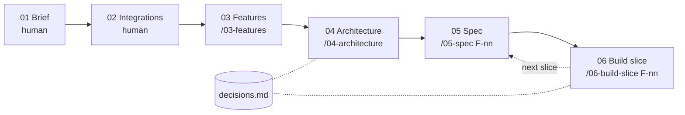

# Digital transformation project · AI harness

A repository template for taking a business's existing process online — from a vague request
to a working, tested vertical slice — with AI doing the structuring and building, and humans
owning discovery and every decision.

**Use:** "Use this template" on GitHub → one repo per client project.

## Why a harness, not just prompts

- **The repo is the single source of truth.** Brief, features, diagrams, specs and decisions
  live next to the code as Markdown + Mermaid. They are the AI's context — nothing gets lost
  copying between a whiteboard, a notes app and a prompt.
- **Every step is traceable.** Features cite brief sections, tests are named after Gherkin
  scenarios, deviations become decision records. Anything the AI had to assume is listed, not hidden.
- **Humans decide, AI proposes.** Each skill ends at a review point. Scope proposals carry a `?`
  until a human removes it.
- **Quality gates are automatic.** Hooks lint every edit and run the tests before Claude may
  declare a step done.

## Process



| Step | What happens | Review point |
|---|---|---|
| 01 Brief | Discovery interview, notes typed live into 10 sections | — |
| 02 Integrations | Register of external systems: real, fake or out of scope | — |
| 03 Features | Job stories, Kano classification, AI opportunities, proposed scope, cut list | Validate must-bes with the business; remove the `?` |
| 04 Architecture | Context, data model, key flows, API surface, scalability notes | Review diagrams; accept/reject proposed decisions |
| 05 Spec | 4–6 Gherkin scenarios for one feature | Edit scenarios — they become the tests |
| 06 Build slice | Plan → tests → data → API → thin UI, committed at each green checkpoint | Approve the plan; review migration and diffs |

Numbers follow the process; each skill carries the number of the document it produces.
Steps 01–02 have no skill on purpose: discovery is a conversation between people.

## Quick start

```bash
cp .env.example .env
docker compose up --build -d
open http://localhost:5173          # walking skeleton: shows backend + DB health
claude                              # then: /03-features once the brief has content
```

Recommended VS Code extensions (prompted on open): Mermaid preview, Ruff, Oxc.

**First run in a new fork:** start `claude` interactively once and accept the workspace trust
prompt — until then Claude Code ignores the project's `.claude/settings.json` (permissions and hooks).

## Sizing

The four skills are sized for an MVP-scale project with a reasonably familiar domain. For vaguer
domains, split them further: discovery synthesis, user journeys, domain model and NFRs as
separate steps — the numbering scheme leaves room.

## Layout

```
CLAUDE.md          how we work: process, IDs, guardrails, stack
decisions.md       why: ADR-lite decision log (D-nn)
docs/              what: 01-brief → 05-specs
.claude/skills/    03-features · 04-architecture · 05-spec · 06-build-slice
.claude/hooks/     post-edit lint/format · pre-stop tests
backend/           FastAPI · SQLAlchemy · Alembic · pytest
frontend/          React · Vite · TypeScript · vitest
```
