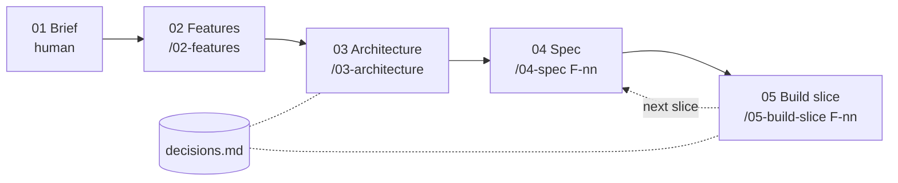

# Digital transformation project · AI harness

A repository template for taking a business's existing process online — from a vague request
to a working, tested vertical slice — with AI doing the structuring and building, and humans
owning discovery and every decision.

**Use:** "Use this template" on GitHub → one repo per client project.

## Framework, not a solution

A fresh fork contains **no domain**: no entities, no endpoints, no features, and every document
under `docs/` is an empty template. What it does contain are the engineering decisions that
are the same for every project — made once, upfront, so that project time goes into the
client's problem rather than into setup.

Upfront does not mean immutable: each decision is an accepted row in `decisions.md` with a
"revisit when" trigger, and a project changes it the same way it records any other decision.
The full inventory is in [What a fresh fork contains](#what-a-fresh-fork-contains).

## Why a harness, not just prompts

- **The repo is the single source of truth.** Brief, features, diagrams, specs and decisions
  live next to the code as Markdown + Mermaid. They are the AI's context — nothing gets lost
  copying between a whiteboard, a notes app and a prompt.
- **Every step is traceable.** Features cite brief sections, tests are named after Gherkin
  scenarios, deviations become decision records. Anything the AI had to assume is listed, not hidden.
- **Humans decide, AI proposes.** Each skill ends at a review point. Scope proposals carry a `?`
  until a human removes it.
- **Quality gates are automatic.** Hooks lint every edit and run the tests before Claude may
  declare a step done.

## Process



| Step | What happens | Review point |
|---|---|---|
| 01 Brief | Discovery interview in business language, typed live into 11 sections | — |
| 02 Features | Blocking assumptions with scope branches, job stories, Kano classification, AI opportunities, proposed scope, cut list | Ask the blocking questions and validate must-bes with the business; apply answers with `/02-features A-nn <answer>`; remove the `?` |
| 03 Architecture | Context, capability register, data model, key flows, API surface, scalability notes | Review diagrams; accept or reject proposed decisions |
| 04 Spec | 4–6 Gherkin scenarios for one feature | Edit scenarios — they become the tests |
| 05 Build slice | Plan → tests → data → API → thin UI, committed at each green checkpoint | Approve the plan; review the migration and diffs |

Numbers follow the process; each skill carries the number of the document it produces.
Step 01 has no skill on purpose: discovery is a conversation between people.

## Scope levels

| Scope | Meaning |
|---|---|
| `v0` | First working build, to validate with the business — capabilities may be fake |
| `v1` | First release to real customers — every capability real |
| `v2` | Next iteration after launch |
| `cut` | Not building, with the reason recorded |

## What a fresh fork contains

| Area | Decided upfront | Left to the project | Where |
|---|---|---|---|
| Process | Five steps, each ending at a human review; numbered docs and skills; scope levels `v0`–`v2`; the reviewer's commit is the approval | The content of every document | `CLAUDE.md`, `docs/`, `.claude/skills/` |
| Traceability | IDs for brief sections, assumptions, features, capabilities, scenarios and decisions; uncited content becomes an explicit assumption | — | `CLAUDE.md` |
| Stack (D-02) | React + Vite, FastAPI, SQLAlchemy 2.0 + Alembic, PostgreSQL 17, docker-compose with hot reload | Data model, endpoints, pages | `backend/`, `frontend/` |
| Walking skeleton | Frontend → API → database wired, health-checked and tested; layered backend (models, schemas, services, routers); idempotent seed script | Everything the features need | `backend/app/`, `frontend/src/` |
| Testing (D-03, D-04) | Gherkin scenarios map 1:1 to tests; a traceability test enforces it; backend tests run on real Postgres, one rolled-back transaction each | The scenarios | `docs/04-specs/`, `backend/tests/` |
| Quality gates | Lint and format after every AI edit; tests before the AI may finish a turn; the AI can commit but never push | — | `.claude/hooks/`, `.claude/settings.json` |
| External capabilities (D-01) | Capabilities behind ports named after the capability; in-process fakes that mirror async callbacks; real or fake chosen per capability | Which capabilities are needed, keep/replace/add, vendors | `backend/app/integrations/` |
| AI capability (D-05) | One structured-generation port (validated output or an explicit error); deterministic fake for tests; versioned prompts; golden-case evals with a pass-rate threshold; human decision and audit record per generation | Whether a feature uses AI; its prompt, schema, eval cases and threshold | `backend/app/integrations/ai.py`, `backend/app/prompts/`, `backend/evals/` |
| Real-time | Polling by default; Server-Sent Events for streams; WebSocket only when interaction is bidirectional | Whether any feature needs it | `.claude/skills/03-architecture/` |
| Look and feel | Generic stylesheet for semantic HTML; page frame with the brand name top left; brand only as 4 colour tokens + name, with WCAG AA contrast | Brand values (brief §5) | `frontend/src/base.css`, `theme.css`, `brand.ts`, `components/Layout.tsx` |
| Conventions | Conventional Commits; Markdown that renders | — | `CLAUDE.md` |

### How external capabilities work

The business describes what it uses today in plain words (brief §8). Architecture turns that
into a **capability register**: for each capability (taking payment, sending messages, …) it
judges whether today's system fits a web solution and proposes to keep, replace, add or leave
it manual. Because services depend on the port, `v0` runs on fakes while the vendor decision
is made separately before `v1`.

The fakes keep the real shape of the integration: an asynchronous callback arrives over HTTP at
our real inbound route, and a user-facing step (such as a hosted payment page) becomes a plain
stand-in page with one button per outcome — so success, failure and a callback that never
arrives can all be tried by hand.

### How AI features work

Scenarios specify the behaviour *around* the model — suggestion shown, human accepts or edits,
fallback when the model fails — and run against the fake, so tests stay deterministic and the
hooks never call a model. Output quality is measured separately by evals against the real model.

## Quick start

```bash
cp .env.example .env              # add ANTHROPIC_API_KEY + AI_MODE=real for AI features
docker compose up --build -d
open http://localhost:5173          # walking skeleton: shows backend + DB health
claude                              # then: /02-features once the brief has content
```

Recommended VS Code extensions (prompted on open): Cucumber (Gherkin), Ruff, Python, Oxc.
Mermaid preview is built into VS Code 1.121+ — don't also install *Markdown Preview Mermaid
Support*: two renderers make diagrams flash and disappear. On older versions, install it instead.

**First run in a new fork:** start `claude` interactively once and accept the workspace trust
prompt — until then Claude Code ignores the project's `.claude/settings.json` (permissions and hooks).

## Sizing

The four skills are sized for an MVP-scale project with a reasonably familiar domain. For vaguer
domains, split them further — discovery synthesis, user journeys, domain model and
non-functional requirements as separate steps. The numbering scheme leaves room.
